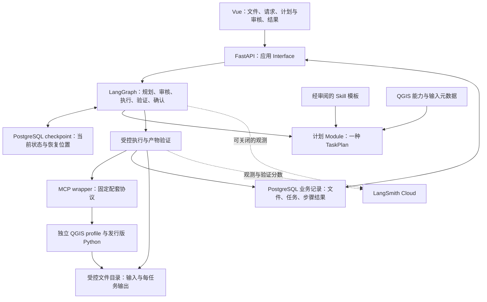

# QGIS Workflow Agent V1 架构

本页拥有 Module 职责和运行语义；用户范围与验收以[规格](../specs/0001-qgis-workflow-agent-v1.md)为准。本页描述目标职责；各切片的实现与验收状态以 [GitHub 任务](../tickets/README.md)为准。

## 总体数据流

保持一个应用后台进程，MCP wrapper 与 QGIS 继续独立。PostgreSQL 是唯一应用数据库；模型使用 DeepSeek/OpenAI-compatible 入口，具体可用模型在环境验收时验证，模型更换不混入模板效果实验。

FastAPI 是面向用户的业务入口，LangGraph 在此范围内执行审核、单执行限制和业务记录。MCP 是本机受信进程之间的内部 GIS Adapter；直接连接 MCP 的开发调用位于应用审核边界之外，不能作为“所有调用均经过人工审核”的证据。运行入口保持回环绑定。

## 四个主要 Module

| Module      | 对调用方的 Interface 与职责                                                             | 不承担的职责                                             |
| ----------- | --------------------------------------------------------------------------------------- | -------------------------------------------------------- |
| 计划        | 需求、文件引用、能力事实、可选模板与意见 → 类型化待审核 TaskPlan；校验完整步骤和调用    | 不授权执行，不通过自由文本补出隐式调用                   |
| 运行        | 提交、查询、审核、风险决策、结果确认、恢复；统一 graph 与 SSE；保存业务结果             | 不自建通用编排平台、遥测系统或另一套状态机               |
| GIS Adapter | 有限命名工具、算法元数据、实际执行、输入与产物验证；真实 QGIS 与测试 fake 位于这个 Seam | 不导入 Agent venv 到 QGIS，不允许任意模型代码            |
| Web UI      | 一个会话快照的展示、文件引用、计划/风险/结果交互；浏览器可验证                          | 不自行判断成功，不从文本和多个布尔变量推导另一套业务真值 |

Seam 只放在确实需要替换的位置：真实模型/测试 fake、真实 GIS/测试 fake。对外方法少，底层步骤在 Implementation 内聚合；不为只有一种数据库或观测平台的实现创建抽象工厂。

## 计划与调用

- TaskPlan 同时声明步骤、类型化调用、输入/产物引用、关键参数、风险及修订身份。metadata 只保存附加说明，不藏实际工具序列。
- 必要步骤和调用完整对应；步骤 ID 唯一、引用存在、依赖有序，算法/工具在支持清单内。缺少参数或引用时整份计划不可执行。
- 初次模型规划最多两次自动生成，始终需要人工批准；用户意见产生新修订，旧决策返回冲突而不是授权新计划。
- QGIS 返回的临时/实际路径由 Adapter 规范化为产物引用；后一步解析实际产物，不让模型猜测上一步文件名。

## Checkpoint、业务事实与观测

| 数据           | 权威来源                           | 内容和消费方式                                                                            |
| -------------- | ---------------------------------- | ----------------------------------------------------------------------------------------- |
| 当前运行与审核 | PostgreSQL saver 管理的 checkpoint | 当前计划修订、等待决策、执行位置与必要上下文；驱动继续执行                                |
| 文件元数据     | 应用 PostgreSQL 文件记录           | ID、受控相对路径、类型、CRS/图层/字段等；大文件在文件系统                                 |
| 任务与步骤结果 | 应用 PostgreSQL 业务记录           | 输入/计划引用、必要参数、调用前意图、attempt 结果、产物引用、验证及人工结论；用于查询、交付和模板依据 |
| 调试观测       | LangSmith Cloud                    | 图/模型/工具调用树、调试输入输出、耗时、token、错误筛选和实验分析；不驱动批准或恢复       |

业务层以文件、任务执行和步骤尝试三类小表表达，不引入通用事件表或 ORM 框架。附加字段可用受约束 JSONB，查询身份和核心结果显式列出。Checkpoint 内只保留恢复需要的上下文或记录引用，不反复复制整份长期调试日志。

现有 ExecutionTrace 迁为上述必要执行记录：可保留名字或最后更名，但迁完消费点就删除旧形态。任务步骤结果从一次执行中产生一次；平台接收分析副本，不再独立判断同一任务成功。原 execution_logs 与 Cookbook 读链在替换验收后停止作为默认写入来源，不双写两套业务真值；旧数据如确需保留另做导出，不在首期自动 DROP 未核实数据。

批准状态以 checkpoint 中当前决策为准；业务记录可保存已经发生的审核事实供历史查看，不再用历史快照推进当前 graph。页面阶段由当前 graph 等待点和结果投影，不另维护一套 phase 状态。

调用前意图是尚未取得可靠结果的业务事实。执行区占用及 PostgreSQL 中匹配任务、修订和批准计划的原子更新共同防止重复写入；它们不能替代 checkpoint 中的当前批准。每次外部写入先持久化意图，再发送调用并记录结果。若返回或结果保存失败，后续恢复必须核查该意图，不能因 graph 仍指向执行节点就重发。

## 正常任务路径

1. 上传或选择文件，读取必要元数据；请求引用稳定文件 ID。
2. 查询受支持能力、可选 Skill；生成和验证一份 TaskPlan。
3. 展示实际算法、参数及引用，等待计划审核；拒绝后带意见生成新修订。
4. 执行前检查当前批准、工具/路径/参数与单执行限制；按需进入风险审核。
5. 每一步记录执行尝试，调用固定协议的 QGIS；规范化结果并验证产物。
6. 展示执行与验证结论，等待用户确认；保存人工反馈和最终摘要。
7. 有观测配置时上报并关联 LangSmith；程序关闭时处理必要提交，不让观测开关改变业务路径。

首次提交与恢复提交共用同一事件输出函数。事件用于表达阶段、计划、工具进度、错误、审核请求和最终结果；不以 `<think>` 或模型自由文本作为流程控制协议。

## 审核、幂等与执行限制

- 审核决策绑定会话、业务任务、计划修订或当前风险调用身份。相同已处理决策返回当前结果，过期或不匹配决策拒绝。
- 计划、风险及结果三个等待点由 checkpoint 投影成同一快照，刷新或重选会话重新读取。关闭审核展示不提交决定；未作出对应决定时，恢复请求不能跳过等待点。审核保存与 checkpoint 更新由同一后台所有者完成，HTTP 请求取消不提前释放该所有权。
- 同一任务已在运行时重复 resume 不再启动第二次运行。后台执行拥有运行生命周期，HTTP 流只订阅事件；浏览器断连后后台继续处理，直到调用结果与 checkpoint 保存完成。GIS 执行区单独原子占用，忙时立即提示、不排队；重新规划和结果说明不占用 GIS 执行区。
- 单个 QGIS 工程可变，因此同一时间只执行一项任务；不同任务使用独立输出目录和明确图层引用，避免依赖未指定的当前选中图层。
- 仅读取或确定可安全重试的连接请求有限重试。写操作开始后结果不明，记录 needs-attention/结果未知，不通过自动协议切换或重新进入 graph 重放。
- 风险暂停后的继续执行须核对 checkpoint 中的修订、调用、游标与已完成尝试，并与业务记录中的暂停事实一致；任何一侧缺失或不匹配都需核查。进程重启后没有本地执行所有者的 running 记录按结果待核查展示，不能据此重发调用。
- 保证审核暂停点的恢复，不承诺执行中副作用 exactly-once。结果未知时用户核查实际产物，再明确选择新任务或后续操作。
- 未知结果的人工核查保留原调用事实、实际所见说明和当前 QGIS 实例的只读信息。核查后仅解除该任务阻止新任务执行的占用，旧任务记为已核查而非成功，不推进其 checkpoint 或重放调用；新任务仍须生成并批准新计划。只读连通不等于产物正确。
- 浏览器“停止读取”与 QGIS“取消计算”分开表达；首期不提供可靠运行中取消，重连先读取快照。

## QGIS、协议与产物

使用发行版 QGIS Python；Agent 使用 uv Python。专用测试 profile 与工程不覆盖用户现有配置。Wrapper 与插件固定同一版本、一个已知协议；首版与仓库配套 raw JSON 协议对齐，保留明确超时和单请求串行，不逐次猜协议。

工具限定为元数据/能力查询、加载、受限 Processing、截图和经风险审核的新工程保存。删除原始数据、任意 execute_code 不暴露给模型。所有输入/输出路径在 Adapter 处集中规范化，处理嵌套 Processing 参数，不只检查顶层 path。

输出在待审计划生成时绑定到本任务、当前修订的受控新路径，具体共享规则由[产物路径模块](../../qgis_mcp_server/qgis_mcp_plugin/artifact_paths.py)拥有。每个产物使用独占新目录，插件在实际写入边界原子保留目录，使主文件和伴生文件都不会覆盖旧资产。调用输出与声明的产物引用一致；执行前再次拒绝既存目标、目录逃逸及原始输入。可信已完成前缀的产物在续跑时检查归属和可读性，后续目标仍须全新。

执行前检查整份计划的原始输入可读性，并将已注册文件与上传时的 checksum 对照；尚未生成的前序产物引用不要求提前存在。输出读回并验证后才标为可交付。工具返回的文件引用、实际可读文件及大小/checksum 是基本执行证据；CRS、字段、几何和独立预期另作空间验证。验证失败的文件可作为诊断产物注明，不显示为成功成果。截图便于查看，不能代替空间验证。统计、合法空结果和错误分别表示。

## Skill 与有限知识依据

Skill 是可复用方案，TaskPlan 是一次实例。六类模板从实际已验证任务整理，版本控制中人工审阅；不同时维护可执行 Cookbook 与另一套 recipe registry。历史案例只从业务记录派生，不拥有执行授权。

完整占位符保留 number/bool 等类型，字符串内插仅用于明确字符串。模板命中仅帮助生成/渲染草稿，仍经同一校验和审核。图层元数据及算法参数事实比通用文档片段优先；首期不部署向量或图谱服务。

## LangSmith 的接入位置

真实闭环通过后接入官方框架追踪，为 QGIS/MCP 与验证补少量 span；首期配置开关默认关闭，开发/演示按需开启。使用会话、业务 task、attempt 和 case ID 关联；一次任务跨审核恢复可能产生多份 trace，不实现跨暂停点的自制大 Trace。

Prompt、模板、任务定义和 GIS 评价器在 Git 中维护；平台拥有查看和实验分析。仅上传必要文本和元数据，大型输入与空间文件留本地。token 或费用缺失时明确未知。平台不可用时应用继续提供任务和产物，观测失败只影响开发者分析。

## 目录方向

沿用现有前后端和 QGIS 桥接入口，在计划、运行、GIS Adapter、UI 各自范围收敛职责；让后端 main 负责装配，页面负责展示。精确文件划分在目标仓库按真实依赖决定，本规格不要求为每个动词新建文件或类。
