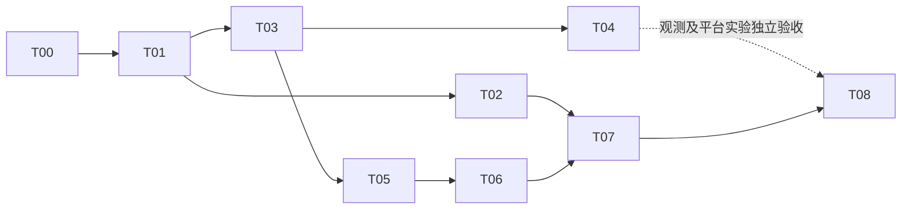

# V1 分阶段实施清单

切片已发布到本项目 GitHub Issues，正式链接见[任务索引](tickets/README.md)。本页拥有阶段依赖和交付门槛；实际进度、领取和验收证据以 GitHub 为准。开发前置配置与原型基线见[环境报告](onboarding/baseline-2026-10-30.md)。

每个行为切片按失败证据 → 最小实现 → 适用检查 → Standards/Spec 两轴审查推进。环境切片是前置验证门槛；其余按完整用户路径交付，不按“先重写全部后端、再重写前端”分工。

## 阶段与交付门槛

| 阶段              | 切片          | 阶段结束必须能展示                                                            |
| ----------------- | ------------- | ----------------------------------------------------------------------------- |
| P0 基线           | T00           | 独立目标 checkout、可重建依赖、项目专用数据库和 QGIS profile；原始检查结果    |
| P1 可信最小闭环   | T01、T02、T03 | 上传→计划→拒绝修改→批准→真实重投影/缓冲→验证→确认；暂停点可恢复；失败不假成功 |
| P2 完整首期与观测 | T04、T05、T06 | 六类任务及两条组合、六类 Skill 模板；可选 LangSmith 独立验收                  |
| P3 实验与交付     | T07、T08      | 留出集与异常集、基线/模板对照、干净重建演示、最终检查及可信简历材料           |

## 切片索引与真实依赖

| ID  | 完整交付                                           | Blocked by                 | 切片范围                                                         |
| --- | -------------------------------------------------- | -------------------------- | ------------------------------------------------------------ |
| T00 | 建立隔离开发基线并记录原始验证                     | 无                         | [环境基线](tickets/00-environment-baseline.md)                |
| T01 | 上传文件，经完整计划审核后在 QGIS 加载并查询结果   | T00                        | [加载闭环](tickets/01-reviewed-layer-load.md)                 |
| T02 | 修改与风险审核、会话切换和重启恢复准确且不重复执行 | T01                        | [审核恢复](tickets/02-review-recovery.md)                     |
| T03 | 重投影→缓冲→查看，结果通过独立空间校验             | T01                        | [首条 Processing 链](tickets/03-verified-processing-chain.md) |
| T04 | 真实闭环后接入可关闭 LangSmith 并关联业务结果      | T03；真实平台凭据          | [可选观测](tickets/04-optional-langsmith.md)                  |
| T05 | 真实裁剪、融合、统计与第二条组合链可交付           | T03                        | [剩余核心任务](tickets/05-clip-dissolve-statistics.md)        |
| T06 | 六类审阅模板在新数据和参数上复用，仍经过审核       | T05                        | [Skill 方案模板](tickets/06-reviewed-skills.md)               |
| T07 | 固定任务集的基线/模板实验、异常专项和原始结果      | T02、T06；平台展示另需 T04 | [真实评测](tickets/07-benchmark.md)                           |
| T08 | 从干净 checkout 重建，交付演示、检查与简历证据     | T07                        | [交付收尾](tickets/08-delivery.md)                            |

T02 与 T03 只有逻辑上的独立性，实施时若触碰同一运行文件，应顺序落地或分配不重叠文件范围。T04 不阻塞 T05/T06/T07 的核心 GIS 验证；平台 key 缺失不能阻止功能和本地实验，但不能把观测验收标成通过。T08 分别报告核心交付和观测增强结果：核心可通过而观测未验收，此时不得宣称整套规划全部完成。T07 的平台实验视图只在 T04 实际通过后使用，本地原始结果仍是可复现实验依据。

## 规格覆盖

| 验收项           | 主要切片      | 最终组合验证                   |
| ---------------- | ------------- | ------------------------------ |
| AC01             | T00           | T08 干净重建                   |
| AC02、AC03       | T01           | T07/T08 回归                   |
| AC04             | T01、T02      | T07 多次拒绝及上限反例         |
| AC05、AC08、AC09 | T02           | T07 真实暂停与重启专项         |
| AC06、AC07       | T03、T05      | T07 留出集                     |
| AC10             | T02、T03、T05 | T07 假成功与异常专项           |
| AC11、AC13       | T04           | 观测开关回归；实际平台独立验收 |
| AC12             | T06           | T07 新数据/参数                |
| AC14             | T07           | T08 原始证据可复现             |
| AC15             | T01、T02      | T08 类型、构建、浏览器深链接   |
| AC16             | T08           | 全部前置验收与两轴审查         |

## 评测执行约定

- 开发集：六类任务各一个，用于模板和评价器开发。
- 留出集：六类任务各两个数据/参数场景，共 12 个场景；各两种中文表述，共 24 个请求。与开发样例分开维护。
- 正式配对比较 A0 无模板、A1 方案模板提示；每个请求建议两次重复，即每组 48 次、两组共 96 次任务运行。先少量试跑估算实际模型费用，再进行完整实验。
- 固定模型、温度、工具目录、QGIS、数据、规则与人工处理口径，配对交错运行。直接渲染模板的快捷路径若启用，另报，不混入提示检索增益。
- 至少八类异常：文件缺失、无可靠 CRS、单位歧义、非法参数、不支持算法、QGIS 中断、未批准/拒绝、过期审核/重复恢复。可有多个子例，不混入正常任务分母。
- 单列浏览器专项：三类暂停点刷新/重启、切会话、取消旧流后开始新流、文本渲染及深链接。
- 指标包括首次计划有效率、首次与最终任务完成率、人工改动率、审核/恢复正确性、假成功、匹配精度/覆盖、规划和执行耗时、token/模型费用及运行复杂度。失败、人工修改、环境中断和缺失 usage 不隐藏。
- 小样本同时报告 n/N 和百分比；P95 附样本量。没有实测前不承诺任务成功率提升幅度。

## 可选后续，非 V1 阻塞项

完整文档 RAG 必须先由 T07 失败分类证明“缺乏可检索知识”是主要原因，再单独写规格与检索消融。多用户、任务队列、可靠运行中取消、自动 Skill 发布、向量/图谱和大型栅格都不随本计划顺带加入。

## 当前状态入口

开发前置配置与实测结果见[环境报告](onboarding/baseline-2026-10-30.md)。任务的正式状态在 [GitHub 索引](tickets/README.md)；本页只拥有阶段依赖和评测口径，不同步 issue 进度。已创建目录或环境连通不能替代 AC 验收；业务完成须以正式 issue 中逐项核对的证据证明。
